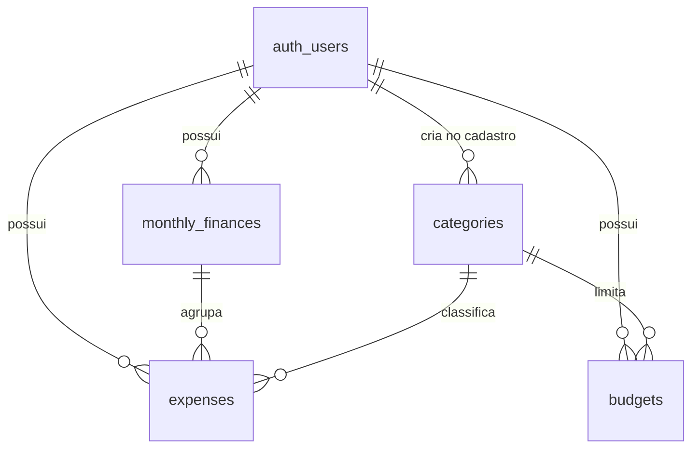

# Banco de dados (Supabase / PostgreSQL) # 

## Como aplicar

1. Abra seu projeto no [painel do Supabase](https://supabase.com/dashboard).
2. Vá em **SQL Editor** → **New query**.
3. Cole o conteúdo de `migrations/0001_initial_schema.sql` inteiro e clique em **Run**.
4. Confira em **Table Editor**: devem aparecer 4 tabelas novas — `categories`, `monthly_finances`, `expenses`, `budgets`.

Rodar o script mais de uma vez dá erro (as tabelas já existem) — isso é esperado, não precisa rodar de novo depois que funcionar.

## Decisões de design

- **Sem tabela `users` própria.** O Supabase Auth já mantém `auth.users` automaticamente. Todas as tabelas abaixo referenciam `auth.users(id)` diretamente, em vez de duplicar.
- **RLS habilitado desde já**, não só na Etapa 12. A chave publishable só é segura de usar com Row Level Security configurado — deixar isso em aberto por várias etapas deixaria dados financeiros reais desprotegidos. Cada tabela tem 4 políticas (select/insert/update/delete), todas na forma `auth.uid() = user_id`: cada usuário só enxerga e mexe no que é dele.
- **Categorias são por usuário, não globais.** Um gatilho (`handle_new_user`) roda automaticamente sempre que alguém se cadastra (insert em `auth.users`) e cria uma cópia das 10 categorias padrão para aquele usuário. Isso bate com o que o documento original pedia (categoria tem campo "Usuário") e permite que cada um renomeie/exclua as suas sem afetar ninguém.
- **Dinheiro como `numeric(12,2)`, nunca float.** Ponto flutuante arredonda errado — inaceitável pra valores financeiros.
- **`expenses` se liga a `monthly_finances` por `monthly_finance_id`**, não por mês/ano soltos — é o relacionamento que o documento original desenhava (usuário → mês → gastos) e evita duplicar a mesma informação em dois lugares.
- **Excluir uma categoria com gastos nela é bloqueado** (`on delete restrict` em `expenses.category_id`) — não dá pra perder histórico financeiro sem querer. Isso pode ser revisto na Etapa 7, quando a exclusão de categorias for implementada de verdade.
- **`updated_at` atualiza sozinho** via gatilho, em `monthly_finances`, `expenses` e `budgets`.

## Esquema

| Tabela | Campos principais | Observação |
|---|---|---|
| `categories` | `name`, `description` | 10 padrão por usuário, criadas automaticamente |
| `monthly_finances` | `month`, `year`, `salary` | 1 linha por usuário+mês+ano (unique) |
| `expenses` | `description`, `amount`, `type` (fixo/variavel), `expense_date`, `notes` | liga a `monthly_finances` e a `categories` |
| `budgets` | `category_id`, `month`, `year`, `limit_amount` | as "caixinhas", 1 por usuário+categoria+mês+ano |

## Testado antes da entrega

Rodei a migração inteira num Postgres local (simulando `auth.users` e `auth.uid()`) e validei: o gatilho semeia as 10 categorias em novos usuários, o RLS isola corretamente dois usuários diferentes, o fluxo salário → gasto soma certo, e as constraints (mês inválido, tipo inválido, valor negativo, mês/ano duplicado) bloqueiam como esperado. Não foi possível testar contra o seu projeto real — meu ambiente não alcança a internet — então a validação final é você rodar o script e conferir o Table Editor.

## Próximos scripts

Novas mudanças de schema (ex: perfis, novos campos) devem virar `0002_*.sql`, `0003_*.sql` etc. — nunca edite `0001` depois que já tiver sido rodado em algum ambiente.
