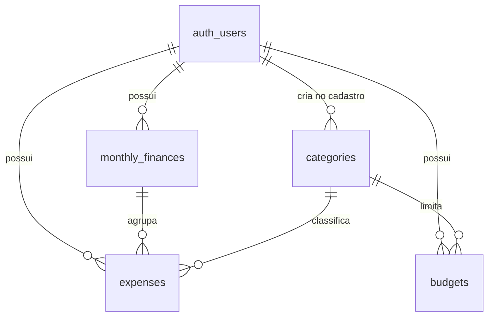

# Banco de dados (Supabase / PostgreSQL)

## Como aplicar

1. Abra seu projeto no [painel do Supabase](https://supabase.com/dashboard).
2. Vá em **SQL Editor** → **New query**.
3. Cole o conteúdo de `migrations/0001_initial_schema.sql` inteiro e clique em **Run**.
4. Confira em **Table Editor**: devem aparecer 4 tabelas novas — `categories`, `monthly_finances`, `expenses`, `budgets`.

Rodar o script mais de uma vez dá erro (as tabelas já existem) — isso é esperado, não precisa rodar de novo depois que funcionar.

## Decisões de design

- **Sem tabela `users` própria.** O Supabase Auth já mantém `auth.users` automaticamente. Todas as tabelas abaixo referenciam `auth.users(id)` diretamente, em vez de duplicar.
- **RLS habilitado desde já**, não só na Etapa 12. A chave publishable só é segura de usar com Row Level Security configurado — deixar isso em aberto por várias etapas deixaria dados financeiros reais desprotegidos. Cada tabela tem 4 políticas (select/insert/update/delete), todas na forma `auth.uid() = user_id`: cada usuário só enxerga e mexe no que é dele.
- **Categorias são por usuário, não globais.** Um gatilho (`handle_new_user`) roda automaticamente sempre que alguém se cadastra (insert em `auth.users`) e cria uma cópia das 10 categorias padrão para aquele usuário. Isso bate com o que o documento original pedia (categoria tem campo "Usuário") e permite que cada um renomeie/exclua as suas sem afetar ninguém.
- **Dinheiro como `numeric(12,2)`, nunca float.** Ponto flutuante arredonda errado — inaceitável pra valores financeiros.
- **`expenses` se liga a `monthly_finances` por `monthly_finance_id`**, não por mês/ano soltos — é o relacionamento que o documento original desenhava (usuário → mês → gastos) e evita duplicar a mesma informação em dois lugares.
- **Excluir uma categoria com gastos nela é bloqueado** (`on delete restrict` em `expenses.category_id`; no PostgreSQL 18+ o erro vem com o código `23001`, antes `23503`, e o backend trata os dois) — não dá pra perder histórico financeiro sem querer. Isso pode ser revisto na Etapa 7, quando a exclusão de categorias for implementada de verdade.
- **`updated_at` atualiza sozinho** via gatilho, em `monthly_finances`, `expenses` e `budgets`.

## Esquema

| Tabela | Campos principais | Observação |
|---|---|---|
| `categories` | `name`, `description` | 10 padrão por usuário, criadas automaticamente |
| `monthly_finances` | `month`, `year`, `salary` | 1 linha por usuário+mês+ano (unique) |
| `expenses` | `description`, `amount`, `type` (fixo/variavel), `expense_date`, `notes` | liga a `monthly_finances` e a `categories` |
| `budgets` | `category_id`, `month`, `year`, `limit_amount` | as "caixinhas", 1 por usuário+categoria+mês+ano |

## Testado antes da entrega

Rodei a migração inteira num Postgres local (simulando `auth.users` e `auth.uid()`) e validei: o gatilho semeia as 10 categorias em novos usuários, o RLS isola corretamente dois usuários diferentes, o fluxo salário → gasto soma certo, e as constraints (mês inválido, tipo inválido, valor negativo, mês/ano duplicado) bloqueiam como esperado. Não foi possível testar contra o seu projeto real — meu ambiente não alcança a internet — então a validação final é você rodar o script e conferir o Table Editor.

## Scripts

| Script | Quando rodar |
|---|---|
| `migrations/0001_initial_schema.sql` | **Sempre, uma vez, primeiro.** Cria as tabelas, o RLS e os gatilhos |
| `migrations/0002_backfill_default_categories.sql` | **Só se** o seletor de categorias do formulário de gastos vier vazio. Acontece com contas criadas *antes* do gatilho da Etapa 3 (ele só semeia as categorias de quem se cadastra depois). Cria as 10 categorias padrão apenas para quem não tem **nenhuma**; pode ser rodado mais de uma vez e não recria categorias que alguém apagou de propósito |
| `migrations/0003_security_hardening.sql` | **Uma vez, depois da 0001** (Etapa 12). Reforça a segurança: chaves estrangeiras do mesmo dono, políticas só para logados, limites de texto e funções protegidas |
| `checks/verificar_seguranca.sql` | **Quando quiser.** Só lê o banco e mostra ✅/❌ para cada item de segurança |

Novas mudanças de schema devem virar `0004_*.sql`, `0005_*.sql` etc. — nunca edite um script depois que ele já tiver sido rodado em algum ambiente.

## Segurança (Etapa 12)

A migração `0003_security_hardening.sql` reforça o que a Etapa 3 já fazia:

- **Chaves estrangeiras "do mesmo dono".** Antes, as chaves estrangeiras ignoravam o RLS: alguém acessando a API do Supabase diretamente, com o próprio login, conseguia criar um gasto *seu* apontando para a categoria ou o mês de outra pessoa, desde que soubesse o UUID. Agora as chaves são compostas, `(id, user_id)`, e a linha referenciada precisa ter o mesmo dono. O banco recusa sozinho, sem depender do backend.
- **Políticas só para usuários logados** (`to authenticated`). Visitante sem login (papel `anon`) não tem nenhuma política, então não lê nem grava nada.
- **`(select auth.uid())` nas políticas**: o Postgres calcula o id do usuário uma vez por consulta, não uma vez por linha. O resultado é o mesmo, mais rápido, e é o formato que o Advisor do Supabase recomenda.
- **Limites de texto também no banco** (nome da categoria ≤ 60, descrição da categoria ≤ 200, descrição do gasto ≤ 120, observação ≤ 500), os mesmos que o backend já valida.
- **Funções com `search_path` fixo**, e `handle_new_user` (que roda com permissões elevadas) não pode mais ser chamada pela API. O gatilho de cadastro continua funcionando normalmente.

Ela roda dentro de uma transação: se algo falhar, nada é aplicado.

### Como conferir

Depois de rodar a `0003`, rode `checks/verificar_seguranca.sql` no SQL Editor. Ele só lê, não altera nada, e mostra uma tabela com ✅ ou ❌ em cada item. Tudo deve aparecer com ✅.

### Testado antes da entrega

As migrações `0001` → `0002` → `0003` foram rodadas num PostgreSQL 18 local, simulando `auth.users`, `auth.uid()` e os papéis `anon` e `authenticated` do Supabase, com dois usuários de teste. Resultado:

- Antes da `0003`, a lacuna foi reproduzida: o banco aceitou um gasto do usuário A com a categoria do usuário B.
- Depois da `0003`, os 28 testes passaram: isolamento entre usuários nas 4 tabelas; FKs recusando mês e categoria de outro dono (insert e update); caminho normal funcionando; exclusão de categoria com gastos bloqueada; limites de texto; `anon` sem acesso; gatilho de cadastro criando as 10 categorias; exclusão de conta apagando em cascata só os dados daquela conta.
- O `verificar_seguranca.sql` mostrou ❌ antes e ✅ em tudo depois.

Rodar a `0003` uma segunda vez dá erro logo no primeiro comando (a constraint já existe), sem alterar nada. Isso é esperado.
